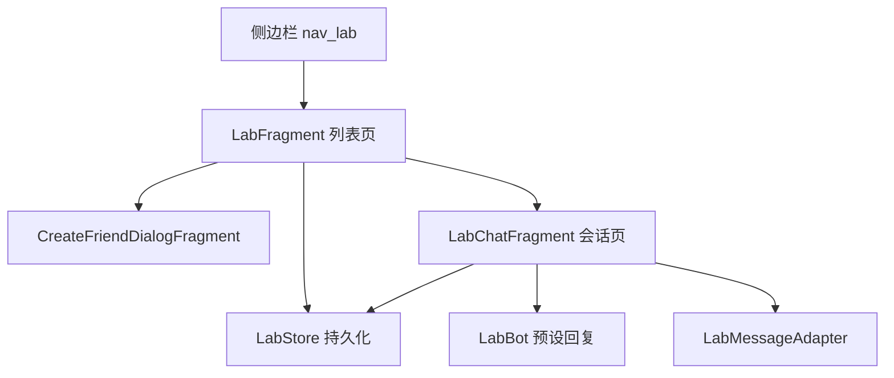

# 实验室沙盒（Lab Sandbox）技术设计

Feature Name: 2026-10-24-lab-sandbox
Updated: 2026-10-24

## 描述

在 App 内新增"实验室"一级页面，提供纯本地模拟的群聊与好友会话：用户创建虚拟群聊或虚拟好友后，以虚拟账号身份发送文本，App 以本地预设规则生成机器人回复。全部数据使用 SharedPreferences + Gson 持久化，头像支持内置图标与相册图片。

服务端不存在向机器人注入虚拟平台事件的接口，因此实验室不调用 `manage/send_message`，消息链路完全在 App 内闭环。

## 架构



## 组件与接口

### LabFragment

- 展示两个分区：群聊、好友；每个分区标题右侧为创建按钮。
- 群聊创建：立即生成 `LabConversation(isGroup=true)`，标题为"实验室群聊 N"，账号名固定，账号 ID 按序号生成。
- 好友创建：弹出 `CreateFriendDialogFragment`。
- 点击会话行跳转 `LabChatFragment`，通过 `conversationId` 参数定位会话。

### CreateFriendDialogFragment

- 字段：头像预览（点击选图）、昵称、QQ 号。
- 选图使用 `ActivityResultContracts.OpenDocument`，成功后 `takePersistableUriPermission`，保证重启后可读取。
- 校验：昵称非空、QQ 号非空且不与现有好友重复；不满足时禁用保存按钮或提示。

### LabChatFragment

- 参数：`ARG_CONVERSATION_ID`。
- 加载会话与历史消息；发送后先追加虚拟账号消息，延迟 400ms 追加机器人回复。
- 会话内消息滚动到底部；输入为空时禁用发送按钮。

### LabMessageAdapter

- 复用 `item_message_send` / `item_message_receive`，按 `LabMessage.fromBot` 选择发送/接收样式。
- 头像通过 `LabAvatarResolver.resolve` 统一解析内置资源与相册 URI。

### LabBot

- 输入文本，返回预设回复：帮助、问候、签到等关键词命中固定文案，未命中返回"（实验室模拟）收到：<文本>"。

### LabStore

- SharedPreferences 名称 `lab_store`，键 `conversations` 保存会话数组，`messages_<id>` 保存消息数组。
- 内存中以 `StateFlow<List<LabConversation>>` 暴露会话列表，写入后同步更新。

## 数据模型

```kotlin
data class LabConversation(
    val id: String,
    val isGroup: Boolean,
    val title: String,
    val accountId: String,
    val accountName: String,
    val accountAvatar: String
)

data class LabMessage(
    val conversationId: String,
    val userId: String,
    val name: String,
    val avatar: String,
    val text: String,
    val fromBot: Boolean,
    val time: Long
)
```

头像字段约定：`builtin:group`、`builtin:friend`、`builtin:bot` 解析为内置向量图，其余按 `content://` URI 加载。

## 正确性原则

1. 会话 ID 全局唯一。
2. 虚拟好友 QQ 号在好友集合内唯一。
3. 消息按时间追加，同一会话的消息顺序稳定。
4. 头像 URI 在应用重启后仍可读取。

## 错误处理

- 选图失败或权限被拒：保留原头像，提示重新选择。
- 会话参数缺失：显示错误提示并返回上一页。
- 持久化失败：捕获异常并记录日志，界面继续使用内存数据。

## 测试策略

- 手动验证：创建群聊/好友、发送消息、收到回复、重启后数据恢复、相册头像重启后仍显示。
- 边界：空昵称、空 QQ、重复 QQ、超长文本、无历史消息的新会话。

## 参考资料

[^1]: (ApiRepository.kt#L139) - 现有聊天 WebSocket 入口，实验室不接入
[^2]: (MessageAdapter.kt#L33) - 现有消息气泡渲染方式，实验室复用同一套布局
